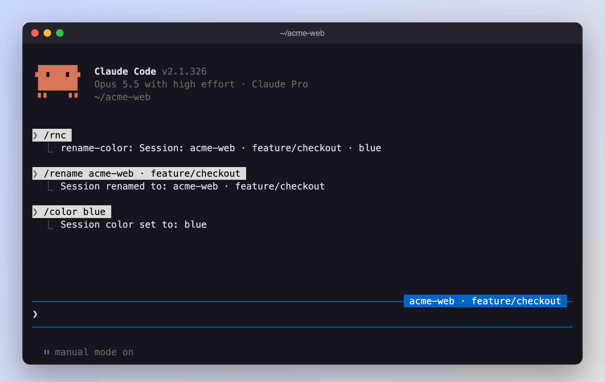
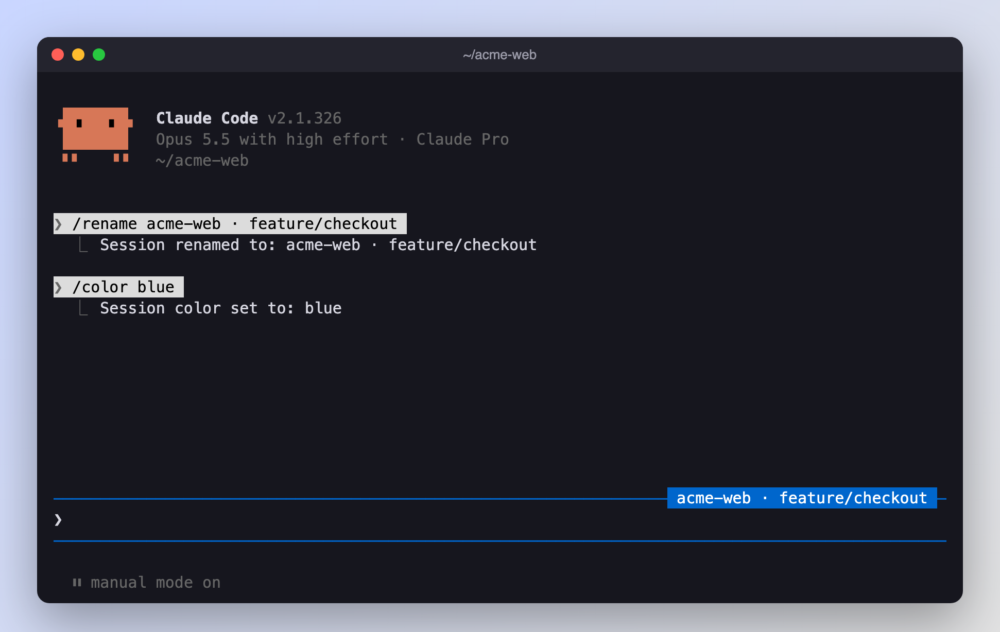

# rename-color

A Claude Code mod that adds `/rnc`: `/rename` and `/color` in one command. With no arguments it names the session after the project folder and git branch, and picks a color from the folder, so every session in the same project gets the same color.



## Usage

| Command | Name | Color |
| --- | --- | --- |
| `/rnc sky copswap blue` | `sky copswap` | `blue` |
| `/rnc sky copswap` | `sky copswap` | fixed color for the project folder |
| `/rnc` | `<folder> · <branch>` (just `<folder>` outside git) | fixed color for the project folder |
| `/rnc blue` | unchanged | `blue` |

If the last word is a color, it is used as the color; everything before it is the name.


Colors: `red`, `blue`, `green`, `yellow`, `purple`, `orange`, `pink`, `cyan`, `default`.

The branch is read straight from `.git/HEAD` (git worktrees included), without starting a git process.

## Auto name and color on new sessions

The `autoOnStart` option (off by default) runs `/rnc` with no arguments when a new interactive session starts. Resumed sessions keep their name.

You can turn it on when installing, or later from `/config` ("Auto name and color on new sessions").



## Install

At the prompt of a Claude Code terminal session:

```
/plugin install rename-color --marketplace luigiPinna/claude-rename-color
```

Answer `y` to add the marketplace, then pick a scope (user scope loads it in every session).

From a shell:

```
claude plugin install rename-color --marketplace luigiPinna/claude-rename-color
```

## Requirements

A recent Claude Code with support for mods (plugins with a hooks module). Tested on Claude Code 2.1.326.

## How it works

A `command.run` hook can't run other commands while it is still answering, because they would wait on the turn it is holding. So `/rnc` returns right away and schedules `/rename` and `/color` with `$.clock.after(0, ...)`.

## Development

```
git clone https://github.com/luigiPinna/claude-rename-color
claude --plugin-dir ./claude-rename-color
claude plugin validate ./claude-rename-color
```

Once Claude Code has loaded the mod, it writes its types to `.claude-plugin/types/`, and `tsc -p .` type-checks it.

## License

[MIT](LICENSE)
