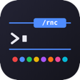
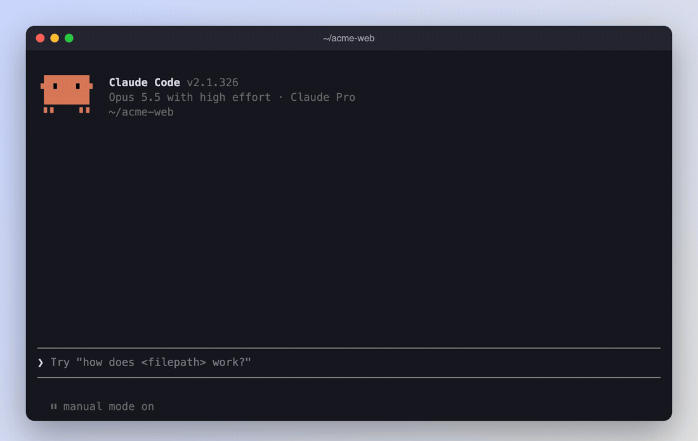
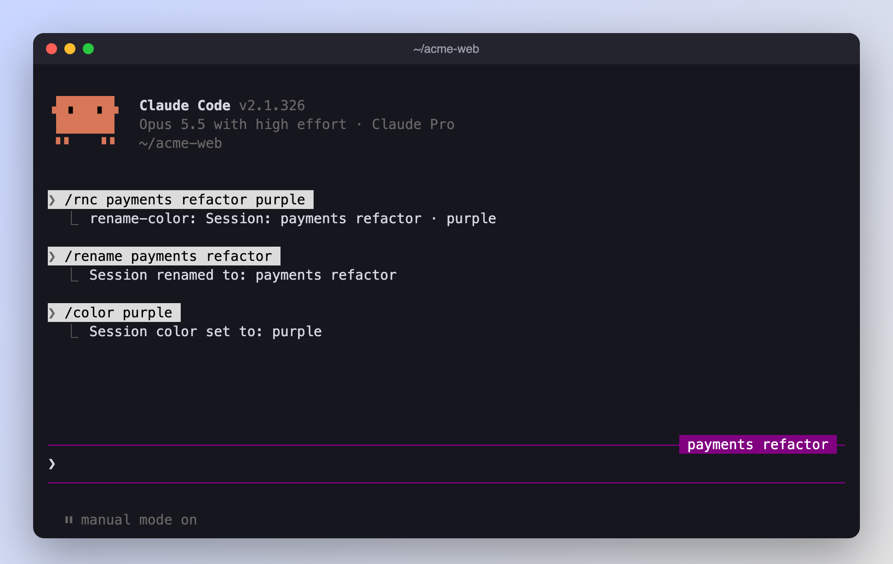

# rename-color

**Name and color your Claude Code sessions in one command, or let them name themselves after the project and git branch.**

[](https://github.com/luigiPinna/claude-rename-color/releases)
[](LICENSE)
[](https://code.claude.com)
[](#how-it-works)



With several Claude Code sessions open in different terminal tabs, they all look the same. Claude Code has `/rename` and `/color` to tell them apart, but that is two commands every time. `rename-color` adds `/rnc`, which does both at once, and can work out a name and a color on its own.

## Contents

- [Features](#features)
- [Install](#install)
- [Usage](#usage)
- [Configuration](#configuration)
- [How it works](#how-it-works)
- [What it reads and runs](#what-it-reads-and-runs)
- [Limitations](#limitations)
- [Development](#development)
- [Contributing](#contributing)
- [License](#license)

## Features

- **One command:** `/rnc <name> <color>` runs `/rename` and `/color` for you.
- **Automatic names:** `/rnc` alone names the session `folder · branch`, git worktrees included.
- **Stable colors:** the color comes from the folder name, so the same project gets the same color in every session, on every machine.
- **Optional auto-start:** turn on `autoOnStart` and every new session names and colors itself. Resumed sessions keep their name.
- **Lightweight:** about 100 lines of TypeScript, no dependencies, no network, no git process.

## Install

At the prompt of a Claude Code terminal session:

```
/plugin install rename-color --marketplace luigiPinna/claude-rename-color
```

Answer `y` to add the marketplace, then pick a scope. The user scope loads it in every session.

From a shell:

```
claude plugin install rename-color --marketplace luigiPinna/claude-rename-color
```

In the desktop app, where `/plugin` doesn't run: click **+** next to the prompt box, then **Plugins**, **Add marketplace** with `luigiPinna/claude-rename-color`, then **Add plugin**.

**Update** with `claude plugin update rename-color`, **remove** with `claude plugin uninstall rename-color`.

**Requirements:** a recent Claude Code with support for mods (plugins with a hooks module). Tested on Claude Code 2.1.326.

## Usage

| Command | Name | Color |
| --- | --- | --- |
| `/rnc sky copswap blue` | `sky copswap` | `blue` |
| `/rnc sky copswap` | `sky copswap` | the project folder's color |
| `/rnc` | `<folder> · <branch>`, or just `<folder>` outside git | the project folder's color |
| `/rnc blue` | unchanged | `blue` |

If the last word is a color, it is the color, and everything before it is the name. Colors are case-insensitive.

Available colors: `red`, `blue`, `green`, `yellow`, `purple`, `orange`, `pink`, `cyan`, and `default` to reset.



## Configuration

| Option | Default | What it does |
| --- | --- | --- |
| `autoOnStart` | off | Runs `/rnc` with no arguments when a new interactive session starts. Resumed sessions keep their name. |

Turn it on when you install, or later from `/config` ("Auto name and color on new sessions").


## How it works

- **Name:** the folder name comes from the session's working directory. The branch is read from `.git/HEAD`; in a git worktree, where `.git` is a file with a `gitdir:` pointer, the mod follows the pointer. A detached HEAD gives just the folder name.
- **Color:** a small hash of the folder name picks one of the eight colors, so it never changes for a given folder.
- **Running the commands:** a `command.run` hook can't run other commands while it is still answering, because they would wait on the turn it is holding. So `/rnc` answers right away and schedules `/rename` and `/color` with `$.clock.after(0, ...)`.
- **Auto-start:** the `session.start` hook registers `/rnc` and, with `autoOnStart` on, checks whether the session already has messages. Only an empty, new session is renamed.

The whole mod is in [`hooks/register.ts`](hooks/register.ts).

## What it reads and runs

- Reads the session's working directory and the `.git/HEAD` file in it (or the one a worktree's `.git` file points to). Nothing else on disk.
- Runs Claude Code's own `/rename` and `/color` commands. With `autoOnStart` on, it also reads whether the session already has messages, to leave resumed sessions alone.
- No network access, no git process, nothing stored. If something fails, it shows one line starting with `rnc: failed:`.

## Limitations

- `/color` accepts only eight colors in Claude Code 2.1.326, so two projects can get the same one. Use `/rnc <color>` to pick another.
- The automatic color comes from the folder name; you can't assign a color to a folder in a config file.
- Tested in the terminal.

## Development

```
git clone https://github.com/luigiPinna/claude-rename-color
cd claude-rename-color
claude plugin validate .
claude --plugin-dir .
```

`claude --plugin-dir .` starts a session with the mod loaded from the folder. Once Claude Code has loaded it, it writes the API types to `.claude-plugin/types/`, and `tsc -p .` type-checks the module.

To try a command without opening a session: `claude -p "/rnc" --plugin-dir .`

## Contributing

Bug reports and ideas are welcome in [Issues](https://github.com/luigiPinna/claude-rename-color/issues). For a pull request, keep the change small, run `claude plugin validate .`, and describe how you tested it.

## License

[MIT](LICENSE) © Luigi Pinna
